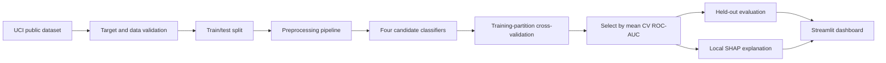

# Project Report

## Explainable AI-Based Machine Learning Framework for Clinical Decision Support Systems

**Project code:** PCS 26 / 125  
**Programme:** B.Tech, Computer Science & Engineering  
**Institution:** Integral University, Lucknow  
**Academic year:** 2026–2027  
**Supervisor:** Dr. S. H. Abbas Rizvi  
**Team:** Zaid Hasan Khan (2300101438), Raza Khan (2300104164), Soyab Khan (2300101263)

## Abstract

This project implements an educational prototype that compares classical machine-learning classifiers on the public UCI Heart Disease dataset and presents model outputs with feature-level explanations. The prototype uses a reproducible preprocessing and training pipeline, evaluates candidate models using a stratified held-out partition and training-partition cross-validation, and calculates local SHAP values for an entered structured record. The interface is intended to demonstrate how explainability can make model behaviour easier to inspect. It is not clinically validated and must not be used to diagnose, screen, treat, or guide care.

## Problem and objectives

Many classification systems expose a predicted class or probability without showing which input features influenced the output. This makes model behaviour difficult to inspect. The project addresses this interpretability gap in a bounded academic example by:

1. Preparing a leakage-aware pipeline for the selected public dataset.
2. Comparing Logistic Regression, Decision Tree, Random Forest, and Gradient Boosting.
3. Reporting accuracy, precision, recall, F1-score, ROC-AUC, confusion matrix, and cross-validation ROC-AUC.
4. Showing per-record SHAP feature contributions and global permutation importance.
5. Providing a Streamlit interface that labels its limitations clearly.

## Dataset and target definition

The implementation fetches dataset 45 from the UCI Machine Learning Repository and uses the 303-record Cleveland subset with 13 selected predictors. The repository outcome `num` is transformed into a binary target: original value `0` maps to class `0`, while values `1` through `4` map to class `1`. Rows without a usable target are excluded. Missing feature values are handled within the fitted model pipeline. Categorical dataset codes are one-hot encoded; continuous predictors are median-imputed, and Logistic Regression also scales continuous values.

This binary mapping is used for the academic demonstration only. It does not define a clinical diagnosis or an individual's medical status.

## System design

The preprocessing transformations are part of each scikit-learn pipeline. Cross-validation is run only on the training partition; the test partition is reserved for final reported metrics. The selected classifier is chosen using mean cross-validation ROC-AUC rather than the test scores.

## Implementation

- `src/data.py` downloads and caches the public UCI dataset, validates the target, and prepares the binary label.
- `src/modeling.py` defines preprocessing and classifiers, performs cross-validation and held-out evaluation, and computes explanations and permutation importance.
- `src/train.py` saves the selected model bundle, comparison table, run summary, evaluation plots, and a held-out SHAP example.
- `app.py` provides the model overview, input form, local explanation, ROC curve, and limitations.
- `tests/test_pipeline.py` checks the data schema, binary target, trained prediction pipeline, and SHAP output.

## Testing and verification

Automated checks ran with `python -m unittest discover -s tests -v`: all three checks passed. They verify the 303 × 13 data schema and binary labels, the trained model's held-out probability output, and finite per-feature SHAP values. The Streamlit browser flow was also exercised: model comparison rendered, a default demo input produced class 0 with a 25.3% model output for class 1, local SHAP contributions rendered, global permutation importance rendered, and the methods/limitations tab displayed. This UI example uses the form's default demonstration values, not a real patient record.

## Results

Run `python -m src.train` to reproduce `reports/model_comparison.csv`, `reports/run_summary.json`, evaluation figures, and the sample SHAP explanation.

| Model | CV ROC-AUC (mean ± std) | Accuracy | Precision | Recall | F1-score | Test ROC-AUC |
|---|---:|---:|---:|---:|---:|---:|
| Logistic Regression | 0.893 ± 0.044 | 0.869 | 0.812 | 0.929 | 0.867 | 0.966 |
| Decision Tree | 0.816 ± 0.024 | 0.770 | 0.719 | 0.821 | 0.767 | 0.877 |
| Random Forest | 0.897 ± 0.045 | 0.869 | 0.812 | 0.929 | 0.867 | 0.960 |
| Gradient Boosting | 0.883 ± 0.052 | 0.902 | 0.867 | 0.929 | 0.897 | 0.957 |

On this fixed 80/20 stratified split (61 held-out records), Random Forest ranked first by mean cross-validation ROC-AUC and was selected. Its held-out confusion matrix, with rows as actual class and columns as predicted class, was `[[27, 6], [2, 26]]`: 27 true negatives, 6 false positives, 2 false negatives, and 26 true positives. The held-out results are descriptive for this split and small dataset; the close cross-validation scores for the leading models do not establish that Random Forest is generally superior.

Held-out permutation importance ranked `cp`, `ca`, `thal`, `exang`, and `oldpeak` highest for the selected model. A Kernel SHAP explanation was generated for held-out record index 219. Its model probability for class 1 was 0.3086 and its predicted class was 0. SHAP contributions describe model output around this record and are not causal or clinical evidence.

The prototype also reports the selected model's confusion matrix and ROC curve, plus held-out permutation feature importance. These are descriptive results on a small historical dataset and should not be generalized to clinical populations.

## Limitations and responsible interpretation

- The dataset is small, historical, and not a representative prospective cohort.
- A random held-out split can produce variable metrics with this sample size.
- The dataset-specific binary target grouping is a modeling choice, not a medical diagnosis.
- Predicted probabilities are not calibrated clinical risk estimates.
- SHAP describes model behaviour; it does not establish causation, correctness, fairness, or safety.
- The project has no external validation, clinical workflow integration, regulatory review, or clinician oversight.
- No real patient records should be entered into the prototype.

## Reproduction

See [README.md](README.md) for installation and run steps. The attributed dataset is bundled, so training and the demo work offline. The fixed random seed is 42. Tested package versions are listed in `requirements.txt`.

## References

1. S. M. Lundberg and S.-I. Lee, “A Unified Approach to Interpreting Model Predictions,” *Advances in Neural Information Processing Systems*, vol. 30, 2017.
2. M. T. Ribeiro, S. Singh, and C. Guestrin, “Why Should I Trust You?: Explaining the Predictions of Any Classifier,” *Proceedings of the 22nd ACM SIGKDD International Conference on Knowledge Discovery and Data Mining*, pp. 1135–1144, 2016.
3. T. Chen and C. Guestrin, “XGBoost: A Scalable Tree Boosting System,” *Proceedings of the 22nd ACM SIGKDD International Conference on Knowledge Discovery and Data Mining*, pp. 785–794, 2016.
4. A. Janosi, W. Steinbrunn, M. Pfisterer, and R. Detrano, “Heart Disease [Dataset],” UCI Machine Learning Repository, 1989. DOI: [10.24432/C52P4X](https://doi.org/10.24432/C52P4X).
5. R. Detrano et al., “International Application of a New Probability Algorithm for the Diagnosis of Coronary Artery Disease,” *The American Journal of Cardiology*, 1989.

## Submission checklist

- [x] Install dependencies and run `streamlit run app.py`.
- [x] Run `python -m src.train` and generate the model-comparison CSV, saved model, metrics, and evaluation figures.
- [x] Verify model overview, case prediction, local SHAP explanation, global permutation importance, and method/limitations view in the browser.
- [x] Replace the results placeholders with the generated values and review the discussion.
- [x] Confirm the demo uses the attributed public dataset and the browser check used only form defaults, not patient records.
